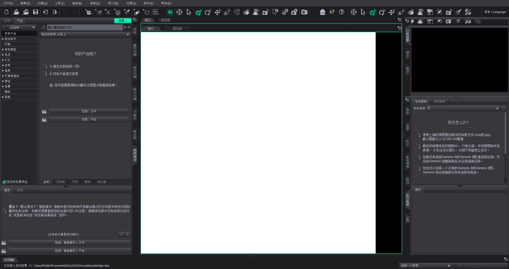
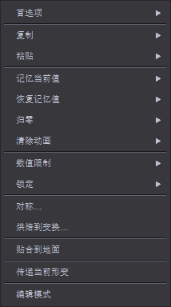
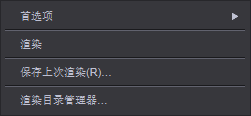

# Daz Studio 6.26 简体中文界面语言插件 (Simplified Chinese UI Plugin)

[](https://www.daz3d.com/)
[-success)](source/dazzhcn.cpp)
[-green)](build-info.json)
[](LICENSE.txt)

面向 **Daz Studio 6.26 (`6.26.2026.30901`, Windows x64, Qt `6.10.3`)** 的原生简体中文界面汉化插件。采用 **Daz Studio 6.26 原生 SDK 插件接口 (`DzPlugin` ABI) + Qt `QGenericPlugin` 双模架构**，支持词库热重载、中英界面实时切换、3D 视口 HUD 与方位方块汉化，且不改写任何官方程序文件、场景节点内部标识或素材文件。

> 详细中文说明请参阅 [README-简体中文.md](README-简体中文.md)，完整实机验收报告请参阅 [reports/验收结果.md](reports/验收结果.md)。

---

## 核心特性

- **Daz 6.26 原生 SDK 插件 (`DzPlugin`) + Qt 双模兼容**：
  - 完整实现 Daz Studio 6.26 原生插件 `.dz_sdk` 版本段 (`dzPluginSDKVersionTag`)、`getSDKVersion` (`6.26.2026.30200`) 与 `getPluginDefinition` 接口，向 `DzPluginMgr` 注册 `DzPlugin`，可在 **帮助 → 关于已安装插件 (About Installed Plugins)** 中查看。
  - 同时支持放入 Daz 官方 `plugins/` 目录原生加载，或免管理员权限安装至 `%LOCALAPPDATA%\DazStudioZhCN` 通过启动入口加载。
- **全界面与 3D 视口深度汉化**：
  - 覆盖主菜单、工具栏、Parameters（参数）、Surfaces（表面/材质）、Shaping（塑形）、Posing（姿态）、Render Settings（渲染设置）、Simulation Settings（模拟设置）、Smart Content / Content Library 及面板右键/选项菜单。
  - 完整汉化 3D 视口右上角视图选择器（`Perspective View` → **`透视视图`**）及相机方位方块六个面（`Front / Back / Top / Bottom / Left / Right` → **`正面 / 背面 / 顶面 / 底面 / 左侧 / 右侧`**）。
- **零数据污染与高稳定性**：
  - 仅在 UI 显示与绘制层（`QTranslator` + `DzStyle` / `QPainter` 副本绘制）替换可见文本，**绝不修改** `DzNode`、`DzProperty`、骨骼内部名称、脚本代码、文件路径或保存的 `.duf` / `.obj` 数据。
  - 退出前自动还原菜单栏原文并卸载临时语言工具栏，确保 `layout.dsx`、`toolbars.dsx`、`actions.dsx` 零篡改。
- **开放可编辑词库（30,271 条主词库 + 1,435 条人工校对术语）**：
  - 支持通过 `dictionary/overrides.json` 自定义修订词条，在软件内点击 **语言 / Language → 重新加载词库** 即可即时生效，无需重新编译。

---

## 界面预览

| 主界面与菜单汉化 | 3D 视口（`透视视图` 与 `正面/左侧/顶面` 方位方块） |
| :---: | :---: |
|  |  |

| 参数面板与选项菜单 | 渲染设置面板与选项菜单 |
| :---: | :---: |
|  |  |

---

## 快速安装与使用

1. 可直接从 [Releases](../../releases) 下载最新打包好的 `DazStudio-简体中文-6.26.2026.30901-Windows64-含源码词库.zip` 并解压（或直接克隆本仓库）。
2. 正常关闭 Daz Studio。
3. 双击运行 **`安装汉化.cmd`**（内部调用 `Install.ps1`）：
   - 默认安装到 `%LOCALAPPDATA%\DazStudioZhCN`，并在桌面生成 **`Daz Studio 简体中文.cmd`** 与 **`Daz Studio 英文.cmd`**。
   - 若以管理员权限运行，还会自动将 `dazzhcn.dll` 与 `dazzhcn-root.txt` 部署至 `C:\Program Files\DAZ 3D\DAZStudio6\plugins\`。
4. 使用桌面的 **`Daz Studio 简体中文.cmd`** 启动软件。
5. 软件顶部工具栏提供 **`语言 / Language`** 按钮，可随时执行：
   - **简体中文 / English** 实时切换
   - **重新加载词库 / Reload Dictionary**
   - **导出漏翻清单 / Export Report**
   - **离线中文帮助 / Offline Help**

### 卸载

关闭 Daz Studio，运行安装目录中的 **`卸载汉化.cmd`**（或 `Uninstall.ps1`）。卸载脚本会自动备份您的 `dictionary/` 自定义词库到“文档\DazStudioZhCN词库备份”，并清理桌面快捷命令及插件文件。

---

## 目录结构

```text
runtime/                 插件二进制 (runtime/generic/dazzhcn.dll) 及 Qt 官方简体中文 .qm 语言文件
dictionary/              主词库 (zh_CN.json)、术语表 (glossary.tsv)、用户自定义词库 (overrides.json)
source/                  C++17 插件源码 (dazzhcn.cpp, paintadapter.h, graphicstext.h, CMakeLists.txt)
help/                    离线中文操作说明与本地帮助文档
tools/                   构建脚本 (build_plugin.py)、词库生成、自动化实机验收与打包脚本
reports/                 实机验收报告 (验收结果.md)、截图与兼容性校验记录
Install.ps1 / .cmd       安装脚本与入口
Uninstall.ps1 / .cmd     卸载脚本与入口
Start.ps1 / .cmd         中英文启动入口
Check-Compatibility.ps1  版本与 SHA256 兼容性检查脚本
```

---

## 从源码编译

需要环境：
- Visual Studio 2022 Build Tools (MSVC v143 x64) + Windows 10/11 SDK
- Qt `6.10.3` (`msvc2022_64`)
- Python 3.9+ 或 CMake 3.21+

```powershell
# 方式一：使用构建脚本
python tools/build_plugin.py --qt-root "C:/Qt/6.10.3/msvc2022_64" --vc-root "C:/Program Files/Microsoft Visual Studio/2022/BuildTools/VC/Tools/MSVC/14.44.35207" --sdk-root "C:/Program Files (x86)/Windows Kits/10"

# 方式二：使用 CMake
cmake -S source -B build-cmake -A x64 -DCMAKE_PREFIX_PATH="C:/Qt/6.10.3/msvc2022_64"
cmake --build build-cmake --config Release
```

---

## 许可证

本项目基于 [MIT License](LICENSE.txt) 开源。第三方组件声明见 [THIRD-PARTY-NOTICES.md](THIRD-PARTY-NOTICES.md)。
